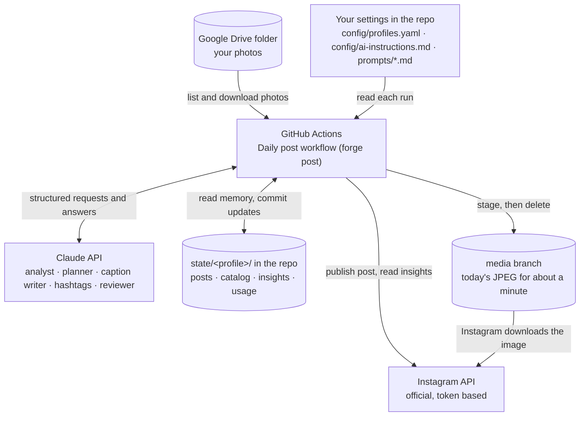

# instaPostsForge

Posts to Instagram once a day from a Google Drive folder: usually one photo, sometimes 2 to 5 photos from one outing or place as a multi-photo post. An AI workflow decides which photo goes out and what it says. Code does the fetching, posting and record-keeping.

It never asks for your Instagram password. You grant it an access token that you can revoke at any time.



[docs/ARCHITECTURE.md](docs/ARCHITECTURE.md) has the full diagrams: the system above, the daily run step by step with its decision points, and how the code is laid out.

## The daily workflow

| # | Step | Who | What happens |
| --- | --- | --- | --- |
| 1 | Fetch results | code | Reads reach, likes, comments, saves and shares for posts from the last 30 days. |
| 2 | Photo analyst | AI | Looks at each new photo in the Drive folder once and notes its subject, setting, mood, colours, style, quality (1 to 10) and themes. The notes are saved in `state/<profile>/catalog.json`. |
| 3 | Planner | AI | Picks today's photo from the unposted ones, or a set of 2 to 5 when they are stronger together (see [Multi-photo posts](#multi-photo-posts)). It balances strong photos with variety, and leans toward what has performed well. It also chooses the angle for the caption. |
| 4 | Prepare image | code | Converts the photo to JPEG at its own aspect ratio. A border is added only if the photo is outside 4:5 to 1.91:1; nothing is cropped. |
| 5 | Caption writer | AI | Writes a hook, a caption in the photo's tone, a quote when one fits, and alt text, in English. A quote's author is kept only when the model is certain of it. |
| 6 | Hashtag strategist | AI | Picks 3 to 5 specific tags (subject, place, niche). It rotates them so the same set isn't reused, and favours tags that brought reach. |
| 7 | Reviewer | AI | Checks the caption and tags against the photo and Instagram's rules. It can send them back up to twice with feedback. Only the part it faulted is redone: tag feedback keeps the caption, caption feedback keeps the tags. |
| 8 | Publish | code | Stages the JPEG (or JPEGs) on this repo's `media` branch, posts through the official Instagram API, then deletes the staged files. |
| 9 | Record | code | Saves the post under a hash of each photo's Drive file ID in `state/<profile>/posts.json`, so none of its photos is ever picked again. |

Every AI step has a safe fallback. If the planner fails or names a photo that doesn't exist, a random unposted photo is used. If the reviewer still rejects the post after two revisions, nothing is posted that day and the run fails visibly. Hashtags that break a rule (too few, generic, more than 5) are sent back automatically.

## Design pattern

This is an **AI workflow**, not an autonomous agent, in the terms of Anthropic's [Building effective agents](https://www.anthropic.com/engineering/building-effective-agents). Code runs fixed steps and calls Claude at five of them. It uses:

- **Prompt chaining with gates**: each AI step feeds the next, and code checks the output in between (the photo must exist, captions and tags must pass Instagram's rules).
- **Evaluator-optimizer**: the reviewer approves or sends feedback, and the writers revise, up to `ai.max_revisions` times.
- **Augmented LLM**: every call returns a typed schema and gets memory from `state/` (catalog, history, insights).
- **Guardrails and fallbacks**: code, not the model, enforces limits and decides what happens when an AI step fails.

The architecture doc explains why, and which patterns (routing, parallelization, orchestrator-workers) could be added later.

## Steering the AI

| To change | Edit |
| --- | --- |
| What the account is about: niche, audience, location, voice, words to avoid | `ai.account` in `config/profiles.yaml` (fill this in first) |
| The voice and rules for every AI step | `config/ai-instructions.md` |
| How each kind of photo is written about: hook, length, what to name, quotes, ending, example tags | `config/playbooks/categories.md` |
| The voice for each mood | `config/playbooks/moods.md` |
| What one agent is asked to do | `src/instapostsforge/prompts/<agent>.md` |
| Content rules: quality floor, screenshots, children, near-duplicates, variety | `selection.*` and `ai.planning` in `config/profiles.yaml` |
| Which model each agent uses, its effort and token limit | `ai.model`, `ai.effort`, `ai.max_tokens` and `ai.agents.<agent>` in `config/profiles.yaml` |
| Quote policy, hashtag count, review and revisions | `ai.quote`, `ai.hashtags`, `ai.review`, `ai.max_revisions` |

The analyst puts every photo in one of 12 categories (landscape, sky, city, street, people, food, animals, macro, night, travel, event, abstract) and one of 8 moods (calm, joyful, energetic, nostalgic, dramatic, romantic, playful, awe). The later steps get only the playbook sections for that category and mood, so a plate of food and a mountain sunset are written about differently.

Some rules are enforced in code, whatever the AI says:
- Screenshots, memes and photos of documents are never posted.
- Photos where a child is visible are skipped unless `selection.allow_children: true`.
- A near-identical copy of a photo posted in the last 30 days is held back.
- Photos scoring below 4 for quality are used only when nothing better is left.
- No category two days running, no main subject (moon, dog, sunset...) within 3 days even under another category, and at most 2 posts with the same mood in 7 days. If nothing else is left, the repeat goes ahead.
- No quote on food or animal posts, and never a house number, street address or number plate in the text. Homes, cars and belongings are fine to show: the photos are handpicked.
- Captions are short: at most `ai.max_caption_text_chars` (150) characters of text. Code drops body sentences from a longer one, keeping the hook and the closing question, so a long draft never costs the day.
- Explicit or nude photos (`is_explicit`) are never posted.
- If any item on the reviewer's 8-point checklist fails, the post is revised, even if the reviewer said approve.

The agents are `analyst`, `planner`, `caption_writer`, `hashtags` and `reviewer`. `CLAUDE.md` explains the architecture and the rules to keep for anyone (including Claude) working on the code.

## Choosing the model

Every AI step runs on **Claude Sonnet 5.5**. The first runs used Opus 5.5 at medium to high effort and cost about $0.20 per post, which is too much for a daily job. Sonnet costs half as much per token and handles these tasks well: describing a photo, picking from a short list, writing a few sentences, and checking them against a checklist. Code enforces the hard rules anyway, so the model doesn't need to be the strongest.

**Effort** controls how much the model thinks before it answers. Thinking tokens are billed as output, so lower effort costs less.

| Step | Model | Effort | Why |
| --- | --- | --- | --- |
| `analyst` | Sonnet 5.5 | low | Labelling a photo is a description task, and it runs only once per photo |
| `planner` | Sonnet 5.5 | low | Picks from a short list with clear rules; code re-checks variety |
| `caption_writer` | Sonnet 5.5 | medium | The only text people read, so it gets more thought |
| `hashtags` | Sonnet 5.5 | low | Chooses 3 to 5 tags from clear roles; code removes banned tags |
| `reviewer` | Sonnet 5.5 | low | Works through a fixed 8-item checklist |

Every call is capped at 8,000 output tokens. To trade cost for quality, change one step in `config/profiles.yaml`:

```yaml
ai:
  agents:
    caption_writer: { model: claude-opus-5-5, effort: medium }  # best captions, about 2x the cost
    hashtags:       { model: claude-haiku-5-5 }                 # cheapest, fine for simple steps
```

Check the effect with `forge usage -p main`, which totals tokens and estimated cost per step from the audit log.

## Token usage audit log

Every AI call is logged to `state/<profile>/usage/<YYYY-MM>.jsonl`, whether it succeeds or fails. Each entry records the run, agent, model, input, output and cache tokens, time taken, and estimated cost. Each run prints a table of its usage, which also appears on the GitHub Actions run page. For a monthly total:

```bash
forge usage -p main                  # this month
forge usage -p main --month 2026-11
```

Costs are estimates from the per-model prices in `ai.pricing`. Update those if Anthropic's prices change.

## Multi-photo posts

On some days the post is 2 to 5 photos of the same shape that go together instead of one photo. Code finds the candidate sets; the planner decides whether one makes a stronger post than any single photo, and picks the photos and their order. Most days stay single photos.

- **Outings:** photos taken one after another, with no gap over 3 hours (`group_hours`), and within 2 km of each other (`group_km`) when both have GPS. Capture times come from the photo's metadata or its file name, such as `IMG20261018104837.jpg`.
- **Places:** photos from different days taken within 2 km of each other, or with the same place name from the analyst.
- **Rules in code:** every photo must pass the content rules on its own; near-identical frames never share a set; the extra photos must come from the cover's set; at most `max_photos` (5) photos and `max_per_7_days` (3) multi-photo posts in any 7 posts; and the main subject of every photo counts for the variety rules.
- **Shapes:** through the API, Instagram shows every photo in the first photo's shape. So a set only holds photos with the same width:height (to within 1%), and each goes out exactly as shot: no added border, no crop. A portrait and a landscape shot from the same outing are never posted together.
- **Privacy:** GPS is read from Drive's photo metadata during the run, only compared in memory, and never saved: the repo is public.
- **Switch:** set the repository variable `MULTI_PHOTO` to `false` to post single photos only, with no commit. Without the variable, `selection.multi_photo.enabled` in `config/profiles.yaml` decides. `forge check` shows how many photos have a capture time and GPS.

A multi-photo post costs a little more, about $0.08 to $0.12, because the caption writer and reviewer look at every photo in it.

### Why the photo is staged on GitHub

Instagram only accepts a public image link. It rejects Google Drive links, even "direct download" ones. So the run commits the day's JPEG to the `media` branch of this public repo, hands Instagram the `raw.githubusercontent.com` link, and deletes the file right after posting. No storage account is needed.

### Never posting a photo twice

Posted photos are tracked by their Drive file ID in `state/<profile>/posts.json`, so renaming a file doesn't make it eligible again. A photo is recorded only after Instagram confirms the post, and the workflow commits `state/` back to the repo after every run, so the next run (on any machine) knows what was posted. A copy of a recently posted photo saved under a new file is caught too: each photo gets a visual fingerprint, and a near-identical one is held back for 30 days. When every photo has been posted, the run stops with "add more photos". You can set `selection.when_exhausted: recycle` to start over instead.

## Project layout

```
config/profiles.yaml        accounts and AI settings (public: names secrets, never holds them)
config/ai-instructions.md   standing instructions every AI step follows
config/playbooks/           rules per photo category and per mood
CLAUDE.md                   guidance for Claude working on this repo
docs/ARCHITECTURE.md        diagrams and the agentic pattern
.env                        your secrets, local only (copy from .env.example)
state/<profile>/            posts.json, catalog.json, insights.json, usage/ (committed after each run)
src/instapostsforge/
  pipeline.py               the daily workflow
  grouping.py               finds photos that could go out together as one multi-photo post
  agents/                   AI agents: analyst, planner, caption writer, hashtag strategist, reviewer
  prompts/                  one prompt file per agent
  captions/                 Instagram's caption and hashtag rules
  sources/                  where photos come from (google_drive, local_folder)
  imaging/                  JPEG conversion and aspect-ratio handling
  hosting/                  temporary public link for Instagram (GitHub media branch)
  publishers/               Instagram API: publish, insights, token refresh
  state/                    what the workflow remembers per profile
  usage.py                  token audit log
  cli.py                    the `forge` command
tests/                      run without any accounts or keys
.github/workflows/          daily posting job and tests
```

## What you need

Add these under the repo's **Settings → Secrets and variables → Actions → Repository secrets**. Nobody can read a secret back after it is saved, and GitHub hides secrets in logs.

| Secret | Where it comes from |
| --- | --- |
| `ANTHROPIC_API_KEY` | [Claude Console](https://console.anthropic.com/) → API keys → Create key. Add about $5 of credit under Billing. |
| `IG_MAIN_ACCESS_TOKEN` | [developers.facebook.com](https://developers.facebook.com/) → your app → Instagram → API setup with Instagram login → Generate token next to your account, with `instagram_business_content_publish` and `instagram_business_manage_insights`. Valid for about 60 days. |
| `IG_MAIN_USER_ID` | The numeric ID shown next to your account on the same API setup page |
| `DRIVE_FOLDER_MAIN` | Google Drive → right-click the folder → Share → General access: "Anyone with the link", Viewer → Copy link |
| `GOOGLE_DRIVE_API_KEY` | [Google Cloud console](https://console.cloud.google.com/) → new project → APIs and services → enable Google Drive API → Credentials → Create credentials → API key → restrict it to the Drive API |
| `GH_SECRETS_TOKEN` (optional) | GitHub → Settings → Developer settings → Fine-grained tokens → Generate. Only this repository, permission **Secrets: Read and write**. It lets the monthly job save the refreshed Instagram token. |

GitHub provides `GITHUB_TOKEN` and `GITHUB_REPOSITORY` on every run. Under **Variables** (next to Secrets) you can also set:

| Variable | Meaning |
| --- | --- |
| `AUTO_POST` | Set to `true` to let the daily schedule post. Until then only manual runs do anything. |
| `PROFILES` | Which profiles the schedule posts to, as a JSON list. Default `["main"]`. |
| `MULTI_PHOTO` | `false` posts single photos only; `true` allows multi-photo posts. Unset, `selection.multi_photo.enabled` in the config decides (on by default). |

Before the first post, do two things:
1. Switch your Instagram account to **Creator** or **Business** in Settings → Account type and tools.
2. Create an app at [developers.facebook.com](https://developers.facebook.com/), add the **Instagram** product, and add your account as a tester. Because the app only posts to your own account, it can stay in development mode with no app review.

## Running it locally

You need Python 3.10 or newer.

```bash
python -m venv .venv
source .venv/bin/activate        # Windows: .venv\Scripts\activate
pip install -e ".[dev]"
pytest                           # passes without any keys
cp .env.example .env             # then fill it in
```

```bash
forge profiles                   # list profiles
forge plan -p main --days 7      # what the planner would post this week, with reasons
forge preview -p main            # full workflow, saved to drafts/, nothing posted
forge check -p main              # verify the token, quota and Drive folder
forge post -p main               # post today's photo (needs GITHUB_TOKEN in .env)
forge refresh-token -p main      # extend the Instagram token by 60 days
forge usage -p main              # AI tokens and estimated cost this month
```

Instagram tokens last about 60 days. On GitHub, the Refresh Instagram token workflow renews them on the 1st of every month if `GH_SECRETS_TOKEN` is set. Otherwise run `forge refresh-token` at least every 50 days and update `.env` and the GitHub secret.

## GitHub workflows

Everything runs on GitHub Actions, so your laptop isn't needed.

| Workflow | File | Runs when | What it does |
| --- | --- | --- | --- |
| Daily post | `daily-post.yml` | Every day at 13:30 UTC (7:00 pm IST), or by hand | Runs the whole workflow for each profile. By hand you pick a mode: **check**, **plan**, **preview** or **post**. Scheduled runs always post, but only once the `AUTO_POST` variable is `true`. Commits `state/` afterwards. Runs one at a time, so two runs can never post together. |
| Refresh Instagram token | `refresh-token.yml` | 03:00 UTC on the 1st of each month, or by hand | Renews each profile's Instagram token and saves it back to its secret with `GH_SECRETS_TOKEN`. Without that secret it only warns. |
| Tests | `tests.yml` | Every push and pull request | Runs the test suite. It uses no keys and calls no real services. |

The run name shows the mode, for example "Daily post: preview". A preview's summary says plainly that nothing was posted.

## Posting automatically every day

1. Under Settings → Actions → General, allow actions and set Workflow permissions to **Read and write**, so runs can commit `state/` and use the `media` branch.
2. Add the secrets above.
3. Go to Actions → Daily post → Run workflow and run these modes in order:
    1. **check**: verifies the Instagram token, the posting quota and the Drive folder, without calling Claude.
    2. **plan**: shows the next 7 days of photos and why each was picked.
    3. **preview**: download the `preview-main` artifact to see the exact image and caption.
    4. **post**: posts once. Check your feed.
4. Set the repository variable `AUTO_POST` to `true`. From then on the schedule posts every day.
5. To change the time, edit the `cron` line. It is in UTC, and GitHub may start a few minutes late when busy.

After each run, the workflow commits `state/` so the next run knows what was posted, what each photo looks like, and how past posts performed. That commit also keeps the schedule alive: GitHub turns off schedules in a public repo after 60 days without activity. When a scheduled run fails, GitHub emails you, and the run page says why.

## Adding another account or Drive folder

Copy the `main` block in `config/profiles.yaml` under a new name. Point it at new variable names, for example `IG_TRAVEL_ACCESS_TOKEN`, `IG_TRAVEL_USER_ID` and `DRIVE_FOLDER_TRAVEL`. Add them to `.env`, to the repository secrets, and to the commented lines in both workflow files. Add the profile to the `PROFILES` variable, for example `["main","travel"]`. Run it locally with `forge post -p travel`.

Any `defaults` setting can be overridden per profile, for example `ai.account`, `ai.quote`, `ai.playbooks_dir`, `ai.instructions_file` or `selection.strategy`, so a food account and a travel account can follow different rules from the same repo.

## Security

The repo is public, so it is built to hold nothing private:
- Keys, tokens and the Drive folder link live only in `.env` (git-ignored) and in GitHub secrets.
- `state/` keys photos by a one-way hash of their Drive file ID, because a raw ID is enough to download that photo from a link-shared folder. Staged images are named by the same hash.
- In the workflows, secrets are passed only to the step that runs `forge`, never to `pip install` or third-party actions. Actions are pinned to commit SHAs, and Dependabot proposes updates weekly.
- Network errors from the Instagram API never include the request URL, which carries the access token.
- Staged JPEGs are re-encoded without EXIF, so no GPS location or camera data is published.
- The `media` branch starts empty and holds one image for about a minute per post. Preview artifacts expire after 3 days.

In the repo's Settings → Code security, turn on secret scanning, push protection and Dependabot alerts.

## Cost

With the default Claude Sonnet 5.5 at low effort, expect roughly $0.03 to $0.08 per daily post (about $1 to $2.50 a month), plus about $0.01 the first time each photo is analysed. On Opus 5.5 at higher effort, the first runs cost about $0.20 per post. These are estimates: the real cost depends on how many photos are in the folder and how often the reviewer asks for a rewrite. To spend even less, move the analyst, hashtags or reviewer to `claude-haiku-5-5`. `forge usage` shows where the tokens go. Everything else is free: the Instagram API, the Drive API at this volume, and GitHub Actions for a public repo.
