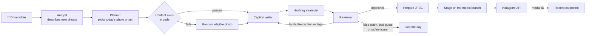
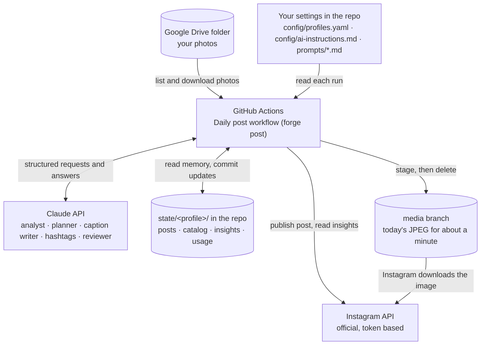

<div align="center">


# instaPostsForge

**Built for photographers whose best shots stay stuck in the gallery.**

One photo a day to Instagram, straight from a Google Drive folder, picked and captioned by Claude, posted by GitHub Actions.

**[See the project page →](https://sritajkumarpatel.github.io/instaPostsForge/)** · **[Use it yourself: setup guide →](https://sritajkumarpatel.github.io/instaPostsForge/setup.html)**

[](https://github.com/sritajkumarpatel/instaPostsForge/actions/workflows/daily-post.yml)
[](https://github.com/sritajkumarpatel/instaPostsForge/actions/workflows/tests.yml)


<sub>Idea by <a href="https://www.linkedin.com/in/sritaj-patel/">Sritaj Kumar Patel</a> · built with Claude</sub>

</div>

---

## Why

Most photographers have a drive full of shots worth sharing and no time to share them. Posting well every day is a chore: pick a photo, avoid repeating last week, write something good, choose hashtags, remember to do it at the right time. instaPostsForge does that for you.

Drop your handpicked photos into a Google Drive folder. Every evening a GitHub Actions job picks one (or a small set from one outing), writes a short caption and hashtags with Claude, checks everything in code, and posts it through the official Instagram API. It never asks for your Instagram password: you grant it an access token that you can revoke at any time. No server and no laptop needed.

The phone version is [Postaday](https://github.com/sritajkumarpatel/postaday-android), which runs the same workflow on Android.

## What it does

| | |
| --- | --- |
| 📁 **Your Drive folder** | Put handpicked photos in one Google Drive folder. Each new photo is described once and remembered. |
| 🤖 **Claude picks and writes** | Five Claude agents describe each photo, choose today's, write the caption and hashtags, and review the post. |
| 🖼️ **Multi-photo posts** | Some days it posts 2 to 5 photos from one outing or place as a carousel, all of one shape. |
| 🛡️ **Code has the last word** | Every AI answer is checked by plain code against Instagram's limits and your content rules before anything is posted. |
| 🙏 **Writes with care** | Short captions (at most 150 characters), playbooks per category and mood, and reverent captions for deities and festivals. |
| ⏰ **Posts on a schedule** | Every day at your time on GitHub Actions, with check, plan and preview modes to look first. |
| ✅ **Never twice** | Posted photos are recorded by their Drive file ID and a visual fingerprint, and are never posted again. |
| 💸 **Know the cost** | Every Claude call is logged with its tokens and estimated cost, and each run saves a token audit report. |
| 🔒 **Safe in a public repo** | Secrets live only in GitHub secrets, GPS is never saved, and published JPEGs carry no EXIF. |

---

## How it works

### A day with instaPostsForge



| # | Step | Who | What happens |
| --- | --- | --- | --- |
| 1 | Fetch results | code | Reads reach, likes, comments, saves and shares for posts from the last 30 days. |
| 2 | Photo analyst | AI | Looks at each new photo in the Drive folder once and notes its subject, setting, mood, colours, style, quality (1 to 10) and themes. The notes are saved in `state/<profile>/catalog.json`. |
| 3 | Planner | AI | Picks today's photo from the unposted ones, or a set of 2 to 5 when they are stronger together (see [Multi-photo posts](#multi-photo-posts)). It balances strong photos with variety, and leans toward what has performed well. It also chooses the angle for the caption. |
| 4 | Prepare image | code | Converts the photo to JPEG at its own aspect ratio, 1080 pixels wide (Instagram's feed width), quality 95 with full colour detail and the photo's colour profile. A photo just outside 4:5 to 1.91:1, like a 3:4 phone portrait, loses a thin centred strip to fit (`image.max_crop`, 10%); only one further outside gets a border. |
| 5 | Caption writer | AI | Writes a short, crisp caption (at most 150 characters of text): a hook, a line in the photo's tone and a closing question, plus a quote when one fits and alt text, in English. A quote's author is kept only when the model is certain of it. A longer draft goes back to the writer once to shorten; code trims whatever is still too long. |
| 6 | Hashtag strategist | AI | Picks 3 to 5 specific tags (subject, place, niche). It rotates them so the same set isn't reused, and favours tags that brought reach. |
| 7 | Reviewer | AI | Checks the caption and tags against the photo and Instagram's rules. It can send them back up to twice with feedback, but after the first round only its first concerns and serious problems count, so it can't keep moving the goalposts. Only the part it faulted is redone: tag feedback keeps the caption, caption feedback keeps the tags. Length isn't its call: code has already counted it, so a length complaint alone never stops a post. |
| 8 | Publish | code | Stages the JPEG (or JPEGs) on this repo's `media` branch, posts through the official Instagram API, then deletes the staged files. |
| 9 | Record | code | Saves the post under a hash of each photo's Drive file ID in `state/<profile>/posts.json`, so none of its photos is ever picked again. |

Every AI step has a safe fallback. If the planner fails or names a photo that doesn't exist, a random unposted photo is used. If the reviewer still rejects the post after two revisions, nothing is posted that day and the run fails visibly. Hashtags that break a rule (too few, generic, more than 5) are sent back automatically.


### Core concepts

- **AI decides, code acts.** The model chooses and writes. Everything with a side effect (fetching, image preparation, hosting, publishing, records) is plain code, and every AI answer is validated before it can reach Instagram.
- **A workflow, not an agent.** In the terms of Anthropic's [Building effective agents](https://www.anthropic.com/engineering/building-effective-agents), code runs fixed steps and calls Claude at five of them:
  - **Prompt chaining with gates**: each AI step feeds the next, and code checks the output in between (the photo must exist, captions and tags must pass Instagram's rules).
  - **Evaluator-optimizer**: the reviewer approves or sends feedback, and the writers revise, up to `ai.max_revisions` times.
  - **Augmented LLM**: every call returns a typed schema and gets memory from `state/` (catalog, history, insights).
  - **Guardrails and fallbacks**: code, not the model, enforces limits and decides what happens when an AI step fails.

  The model gets no tools and chooses no steps. [docs/ARCHITECTURE.md](docs/ARCHITECTURE.md) explains why, and which patterns (routing, parallelization, orchestrator-workers) could be added later.
- **Fail safe.** If the planner fails, a random eligible photo is used. If the reviewer still finds a false claim, a doubtful quote author or a safety problem after its revisions, the day is skipped. A broken post is never published.
- **Instagram limits in code.** At most 5 hashtags and 2,200 characters, JPEG only, aspect ratio between 4:5 and 1.91:1.
- **No repeats.** A photo is keyed by a hash of its Drive file ID, and recorded only after Instagram returns a media ID.

### Architecture



[docs/ARCHITECTURE.md](docs/ARCHITECTURE.md) has the full diagrams: the system above, the daily run step by step with its decision points, and how the code is laid out.

### The agents

Every AI step runs on **Claude Haiku 5.5**, Anthropic's cheapest current model. The first runs used Opus 5.5 and cost about $0.20 per post; Sonnet 5.5 brought that down to a few cents. Haiku costs about a twentieth of Sonnet per token ($0.10 input and $0.50 output per million) and handles these short tasks: describing a photo, picking from a short list, writing a few sentences, and checking them against a checklist. Code enforces the hard rules anyway, so the model doesn't need to be the strongest.

**Effort** controls how much the model thinks before it answers. Thinking tokens are billed as output, so lower effort costs less.

| Step | Model | Effort | Why |
| --- | --- | --- | --- |
| `analyst` | Haiku 5.5 | low | Labelling a photo is a description task, and it runs only once per photo |
| `planner` | Haiku 5.5 | low | Picks from a short list with clear rules; code re-checks variety |
| `caption_writer` | Haiku 5.5 | medium | The only text people read, so it gets more thought |
| `hashtags` | Haiku 5.5 | low | Chooses 3 to 5 tags from clear roles; code removes banned tags |
| `reviewer` | Haiku 5.5 | low | Works through a fixed 8-item checklist |

Every call is capped at 8,000 output tokens. If captions feel flat, move just the caption writer up a model in `config/profiles.yaml`:

```yaml
ai:
  agents:
    caption_writer: { model: claude-sonnet-5-5, effort: medium }  # richer captions, still a few cents a post
```

Check the effect in the run's token audit report or with `forge usage -p main`.

### Tools and tech stack

| Area | What |
| --- | --- |
| Language | Python 3.10+ (3.12 on GitHub Actions) |
| AI | Claude through the official [Anthropic Python SDK](https://github.com/anthropics/anthropic-sdk-python), structured output with Pydantic schemas. Claude Haiku 5.5 by default; Sonnet, Opus and Fable selectable per agent |
| Photos | Google Drive API (link-shared folder and an API key), or a local folder |
| Imaging | Pillow: JPEG at 1080 wide, quality 95, 4:4:4 chroma, ICC profile kept, EXIF removed |
| Hosting | This repo's `media` branch, only while Instagram fetches the photo |
| Publishing | Instagram API with Instagram Login (official, token based) |
| Scheduling and CI | GitHub Actions: daily post, monthly token refresh, tests; actions pinned to commit SHAs |
| Memory | JSON files in `state/<profile>/`, committed after every run |
| Tests | pytest with fakes for Claude, Drive, GitHub and Instagram; no test calls a real API |

---

## Get started

**Want your own copy?** The [setup guide](https://sritajkumarpatel.github.io/instaPostsForge/setup.html) walks through it step by step, in about 45 minutes. In short:

1. Click **Use this template** (or **Fork**) and keep the copy public.
2. Run **Actions → Start fresh** with profile `main`, so your copy has none of the original account's posting history or photo notes.
3. Add the secrets below, then replace the blocks marked **✏️ YOURS TO EDIT** in `config/profiles.yaml` with your own account.
4. Run the Daily post workflow in check, plan, preview and post mode, then set `AUTO_POST` to `true`.

### What you need

Add these under the repo's **Settings → Secrets and variables → Actions → Repository secrets**. Nobody can read a secret back after it is saved, and GitHub hides secrets in logs.

| Secret | Where it comes from |
| --- | --- |
| `ANTHROPIC_API_KEY` | [Claude Console](https://console.anthropic.com/) → API keys → Create key. Add about $5 of credit under Billing. |
| `IG_MAIN_ACCESS_TOKEN` | [developers.facebook.com](https://developers.facebook.com/) → your app → Instagram → API setup with Instagram login → Generate token next to your account, with `instagram_business_content_publish` and `instagram_business_manage_insights`. Valid for about 60 days. |
| `IG_MAIN_USER_ID` | The numeric ID shown next to your account on the same API setup page |
| `DRIVE_FOLDER_MAIN` | Google Drive → right-click the folder → Share → General access: "Anyone with the link", Viewer → Copy link |
| `GOOGLE_DRIVE_API_KEY` | [Google Cloud console](https://console.cloud.google.com/) → new project → APIs and services → enable Google Drive API → Credentials → Create credentials → API key → restrict it to the Drive API |
| `GH_SECRETS_TOKEN` (optional) | GitHub → Settings → Developer settings → Fine-grained tokens → Generate. Only this repository, permission **Secrets: Read and write**. It lets the monthly job save the refreshed Instagram token. |

GitHub provides `GITHUB_TOKEN` and `GITHUB_REPOSITORY` on every run. Under the **Variables** tab (next to Secrets), as **repository variables**, you can also set:

| Variable | Meaning |
| --- | --- |
| `AUTO_POST` | Set to `true` to let the daily schedule post. Until then only manual runs do anything. It must be a **variable**: the check that lets the schedule run happens before any step, and GitHub doesn't let it read secrets, so an `AUTO_POST` secret is ignored. |
| `PROFILES` | Which profiles the schedule posts to, as a JSON list. Default `["main"]`. |
| `MULTI_PHOTO` | `false` posts single photos only; `true` allows multi-photo posts. Unset, `selection.multi_photo.enabled` in the config decides (on by default). Set it under the **Variables** tab, Repository variables (a secret of the same name works too; an Environment variable doesn't). Each run's log says which it used, for example "Multi-photo posts are off (MULTI_PHOTO=false)". |

Before the first post, do two things:
1. Switch your Instagram account to **Creator** or **Business** in Settings → Account type and tools.
2. Create an app at [developers.facebook.com](https://developers.facebook.com/), add the **Instagram** product, and add your account as a tester. Because the app only posts to your own account, it can stay in development mode with no app review.

### Posting automatically every day

1. Under Settings → Actions → General, allow actions and set Workflow permissions to **Read and write**, so runs can commit `state/` and use the `media` branch.
2. Add the secrets above.
3. Go to Actions → Daily post → Run workflow and run these modes in order:
    1. **check**: verifies the Instagram token, the posting quota and the Drive folder, without calling Claude.
    2. **plan**: shows the next 7 days of photos and why each was picked.
    3. **preview**: download the `preview-main` artifact to see the exact image and caption.
    4. **post**: posts once. Check your feed.
4. Set the repository variable `AUTO_POST` to `true` (Variables tab, not Secrets). From then on the schedule posts every day.
5. To change the time, edit the `cron` line. It is in UTC, and GitHub may start a few minutes late when busy.

After each run, the workflow commits `state/` so the next run knows what was posted, what each photo looks like, and how past posts performed. That commit also keeps the schedule alive: GitHub turns off schedules in a public repo after 60 days without activity. When a scheduled run fails, GitHub emails you, and the run page says why.

### Running it locally

You need Python 3.10 or newer.

```bash
python -m venv .venv
source .venv/bin/activate        # Windows: .venv\Scripts\activate
pip install -e ".[dev]"
pytest                           # passes without any keys
cp .env.example .env             # then fill it in
```

```bash
forge profiles                   # list profiles
forge plan -p main --days 7      # what the planner would post this week, with reasons
forge preview -p main            # full workflow, saved to drafts/, nothing posted
forge check -p main              # verify the token, quota and Drive folder
forge post -p main               # post today's photo (needs GITHUB_TOKEN in .env)
forge refresh-token -p main      # extend the Instagram token by 60 days
forge usage -p main              # AI tokens and estimated cost this month
forge reset -p main              # forget posts, insights, usage and photo analyses (--keep-catalog keeps analyses)
```

Instagram tokens last about 60 days. On GitHub, the Refresh Instagram token workflow renews them on the 1st of every month if `GH_SECRETS_TOKEN` is set. Otherwise run `forge refresh-token` at least every 50 days and update `.env` and the GitHub secret.

### GitHub workflows

Everything runs on GitHub Actions, so your laptop isn't needed.

| Workflow | File | Runs when | What it does |
| --- | --- | --- | --- |
| Daily post | `daily-post.yml` | Every day at 13:30 UTC (7:00 pm IST), or by hand | Runs the whole workflow for each profile. By hand you pick a mode: **check**, **plan**, **preview** or **post**. Scheduled runs always post, but only once the `AUTO_POST` variable is `true`. Commits `state/` afterwards. Runs one at a time, so two runs can never post together. |
| Refresh Instagram token | `refresh-token.yml` | 03:00 UTC on the 1st of each month, or by hand | Renews each profile's Instagram token and saves it back to its secret with `GH_SECRETS_TOKEN`. Without that secret it only warns. |
| Tests | `tests.yml` | Every push and pull request | Runs the test suite. It uses no keys and calls no real services. |
| Start fresh | `start-fresh.yml` | By hand only | Clears a profile's posting history, insights, usage log and photo analyses (`forge reset`) and commits the result. Run it once in a new copy of the repo. You must type the profile name to confirm; tick **keep_catalog** to keep the photo analyses. |
| Publish site | `pages.yml` | After the tests pass on a merge to `main`, or by hand | Publishes the project page in `site/` to [GitHub Pages](https://sritajkumarpatel.github.io/instaPostsForge/). One-time setup: Settings → Pages → Source: **GitHub Actions**. |

The run name shows the mode, for example "Daily post: preview". A preview's summary says plainly that nothing was posted.

---

## Using it

### Steering the AI

| To change | Edit |
| --- | --- |
| What the account is about: niche, audience, location, voice, words to avoid | `ai.account` in `config/profiles.yaml` (fill this in first) |
| The voice and rules for every AI step | `config/ai-instructions.md` |
| How each kind of photo is written about: hook, length, what to name, quotes, ending, example tags | `config/playbooks/categories.md` |
| The voice for each mood | `config/playbooks/moods.md` |
| What one agent is asked to do | `src/instapostsforge/prompts/<agent>.md` |
| Content rules: quality floor, screenshots, children, near-duplicates, variety | `selection.*` and `ai.planning` in `config/profiles.yaml` |
| Caption length | `ai.max_caption_text_chars` (150), plus the per-category ranges in `config/playbooks/categories.md` |
| How much of a 3:4 portrait may be trimmed to fit 4:5 | `image.max_crop` (0.1) |
| Multi-photo posts | `selection.multi_photo` in `config/profiles.yaml`, or `MULTI_PHOTO` (a repository variable or secret) |
| Upload size and quality | `image.max_width` (1080) and `image.jpeg_quality` (95) |
| Which model each agent uses, its effort and token limit | `ai.model`, `ai.effort`, `ai.max_tokens` and `ai.agents.<agent>` in `config/profiles.yaml` |
| Quote policy, hashtag count, review and revisions | `ai.quote`, `ai.hashtags`, `ai.review`, `ai.max_revisions` |

The analyst puts every photo in one of 12 categories (landscape, sky, city, street, people, food, animals, macro, night, travel, event, abstract) and one of 8 moods (calm, joyful, energetic, nostalgic, dramatic, romantic, playful, awe). The later steps get only the playbook sections for that category and mood, so a plate of food and a mountain sunset are written about differently.

Some rules are enforced in code, whatever the AI says:
- Explicit or nude photos (`is_explicit`) are never posted. Everything else in the folder is handpicked, so homes, cars and belongings are fine to show.
- Screenshots, memes and photos of documents are never posted.
- Photos where a child is visible are skipped unless `selection.allow_children: true`.
- A near-identical copy of a photo posted in the last 30 days is held back.
- Photos scoring below 4 for quality are used only when nothing better is left.
- No main subject (moon, dog, sunset...) within 3 days even under another category, and at most 2 posts with the same mood in 7 days. If nothing else is left, the repeat goes ahead. Categories (macro, animals...) may repeat on the next day when the subject differs; set `ai.planning.no_repeat_category: true` to forbid that.
- No quote on food or animal posts, and never a house number, street address or number plate in the text.
- Deities, temples, pujas and religious festivals are written about with reverence: the deity is named as devotees do (Maa Durga, Ganpati Bappa, Mahadev), a mantra may be the quote, and the caption ends with the devotional greeting ("Jai Maa Durga 🙏") instead of a question. See "Deities, temples and festivals" in `config/ai-instructions.md`.
- Captions are short: at most `ai.max_caption_text_chars` (150) characters of text. Code drops body sentences from a longer one, keeping the hook and the closing question, so a long draft never costs the day.
- If any item on the reviewer's 8-point checklist fails, the post is revised, even if the reviewer said approve.

The agents are `analyst`, `planner`, `caption_writer`, `hashtags` and `reviewer`. [CLAUDE.md](CLAUDE.md) explains the architecture and the rules to keep for anyone (including Claude) working on the code.

### Multi-photo posts

On some days the post is 2 to 5 photos of the same shape that go together instead of one photo. Code finds the candidate sets; the planner decides whether one makes a stronger post than any single photo, and picks the photos and their order. Most days stay single photos.

- **Outings:** photos taken one after another, with no gap over 3 hours (`group_hours`), and within 2 km of each other (`group_km`) when both have GPS. Capture times come from the photo's metadata or its file name, such as `IMG20261018104837.jpg`.
- **Places:** photos from different days taken within 2 km of each other, or with the same place name from the analyst.
- **Rules in code:** every photo must pass the content rules on its own; near-identical frames never share a set; the extra photos must come from the cover's set; at most `max_photos` (5) photos and `max_per_7_days` (3) multi-photo posts in any 7 posts; and the main subject of every photo counts for the variety rules.
- **Shapes:** through the API, Instagram shows every photo in the first photo's shape. So a set only holds photos with the same width:height (to within 1%), and every photo gets the same treatment (a 3:4 set is trimmed to 4:5 alike), so none gets a border. A portrait and a landscape shot from the same outing are never posted together.
- **Privacy:** GPS is read from Drive's photo metadata during the run, only compared in memory, and never saved: the repo is public.
- **Switch:** set `MULTI_PHOTO` to `false` (a repository variable or secret; any spelling, such as `False`, works) to post single photos only, with no commit. The run log says which setting it used. Without the variable, `selection.multi_photo.enabled` in `config/profiles.yaml` decides. `forge check` shows how many photos have a capture time and GPS.

A multi-photo post costs a little more, because the caption writer and reviewer look at every photo in it.

### Never posting a photo twice

Posted photos are tracked by their Drive file ID in `state/<profile>/posts.json`, so renaming a file doesn't make it eligible again. A photo is recorded only after Instagram confirms the post, and the workflow commits `state/` back to the repo after every run, so the next run (on any machine) knows what was posted. A copy of a recently posted photo saved under a new file is caught too: each photo gets a visual fingerprint, and a near-identical one is held back for 30 days. When every photo has been posted, the run stops with "add more photos". You can set `selection.when_exhausted: recycle` to start over instead. If you delete a post from Instagram and want its photos back in the pool, see [Troubleshooting](#troubleshooting).

### Token usage audit

Every AI call is logged to `state/<profile>/usage/<YYYY-MM>.jsonl`, whether it succeeds or fails. Each entry records the run, agent, model, input, output and cache tokens, time taken, and estimated cost. Each run prints a table of its usage, which also appears on the GitHub Actions run page.

After every run that uses the AI (post, preview or plan, scheduled or manual), the workflow also saves a **token audit report** as a run artifact named `token-audit-<profile>-<mode>-<run number>`. Open the run in the Actions tab and download it from the Artifacts section; it is kept for 90 days. The report (`reports/<profile>-<run id>.md`, plus the same data as `.json`) shows:

- tokens and estimated cost per phase: photo scanning (`analyst`), choosing the photo (`planner`), caption, quote and alt text (`caption_writer`), hashtags and review, with call counts, cache use, seconds and failures;
- every call in order, so a revision or a shortening pass shows up as its own row;
- the month so far, by phase.

The quote is written in the same call as the caption, so its tokens are part of the caption phase. Running `forge` locally writes the same report to `reports/`. For a monthly total:

```bash
forge usage -p main                  # this month
forge usage -p main --month 2026-11
```

Costs are estimates from the per-model prices in `ai.pricing`. Update those if Anthropic's prices change.

### Cost

With the default Claude Haiku 5.5, expect well under a cent per daily post (roughly $0.10 to $0.25 a month), plus a fraction of a cent the first time each photo is analysed. Sonnet 5.5 costs about 20 times as much per token, and Opus 5.5 cost about $0.20 per post. These are estimates: the real cost depends on how many photos are in the folder and how often the reviewer asks for a rewrite. Each run's token audit report and `forge usage` show where the tokens go. Everything else is free: the Instagram API, the Drive API at this volume, and GitHub Actions for a public repo.

### Adding another account or Drive folder

Copy the `main` block in `config/profiles.yaml` under a new name. Point it at new variable names, for example `IG_TRAVEL_ACCESS_TOKEN`, `IG_TRAVEL_USER_ID` and `DRIVE_FOLDER_TRAVEL`. Add them to `.env`, to the repository secrets, and to the commented lines in both workflow files. Add the profile to the `PROFILES` variable, for example `["main","travel"]`. Run it locally with `forge post -p travel`.

Any `defaults` setting can be overridden per profile, for example `ai.account`, `ai.quote`, `ai.playbooks_dir`, `ai.instructions_file` or `selection.strategy`, so a food account and a travel account can follow different rules from the same repo.

---

## Privacy and security

The repo is public, so it is built to hold nothing private:
- Keys, tokens and the Drive folder link live only in `.env` (git-ignored) and in GitHub secrets.
- `state/` keys photos by a one-way hash of their Drive file ID, because a raw ID is enough to download that photo from a link-shared folder. Staged images are named by the same hash.
- In the workflows, secrets are passed only to the step that runs `forge`, never to `pip install` or third-party actions. Actions are pinned to commit SHAs, and Dependabot proposes updates weekly.
- Network errors from the Instagram API never include the request URL, which carries the access token.
- Staged JPEGs are re-encoded without EXIF, so no GPS location or camera data is published. Only the colour profile is kept, so colours look as shot.
- The `media` branch starts empty and holds one image for about a minute per post. Preview artifacts expire after 3 days.

In the repo's Settings → Code security, turn on secret scanning, push protection and Dependabot alerts.

### Why the photo is staged on GitHub

Instagram only accepts a public image link. It rejects Google Drive links, even "direct download" ones. So the run commits the day's JPEG to the `media` branch of this public repo, hands Instagram the `raw.githubusercontent.com` link, and deletes the file right after posting. No storage account is needed.

---

## Troubleshooting

**A run fails with an Instagram error.** The error message names Meta's error code and what to do:

| Code | Meaning | Fix |
| --- | --- | --- |
| 190 | The access token expired or was revoked | Generate a new token in the Meta app (Instagram → API setup with Instagram login) and replace `IG_MAIN_ACCESS_TOKEN` |
| 200, or "API access blocked" | Meta refused access for the app or account | Check the app's Dashboard and Alerts at developers.facebook.com, make sure your account is still a tester and a Professional account, then generate a new token |
| 10 | The token lacks a permission | Generate a new token with `instagram_business_content_publish` and `instagram_business_manage_insights` |
| 4, 17, 32, 613 | Rate limited | Wait an hour and run again |

After a new token, run the workflow in **check** mode before posting.

**"No post today: the caption did not pass review".** After two revisions the reviewer still found a serious problem: a claim that isn't true of the photos, a doubtful quote author, or a safety issue. Style notes (hook, tone, hashtags, alt text) never skip a day: after the first round they are only suggestions, and the best draft is posted. The run page shows each round's feedback. `ai.on_review_reject` changes this: `skip` skips on any concern, `post` always posts.

**The schedule never posts.** Check that `AUTO_POST` is a repository **variable** set to `true`, not a secret. Scheduled runs whose check fails show as skipped on the Actions page.

**Multi-photo posts still go out with `MULTI_PHOTO=false`.** Look for "Multi-photo posts are …" in the Run forge step. If it names the config instead of `MULTI_PHOTO`, the value didn't reach the run: it may be an Environment variable, which this workflow doesn't read.

**You deleted a post from Instagram and want its photos posted again.** Remove that post's entry from `state/<profile>/posts.json` and commit. Each entry is keyed by a hash and shows the photo's `name`; a multi-photo post lists its other photos under `more_photos`, and they are freed with it. The photos' analyses stay in `catalog.json`, so nothing is analysed again. Do this between runs, since every run commits `state/`.

**Start the posting history over.** Run **Actions → Start fresh** with **keep_catalog** ticked, or `forge reset -p <profile> --keep-catalog` and commit. By hand: replace `state/<profile>/posts.json` and `insights.json` with `{}` and commit. Every photo becomes unposted, and the subject, mood and repeat rules start fresh. Keep `catalog.json`, so no photo is analysed (and paid for) again.

**Two posts on one day.** Scheduled runs post once a day, but every manual run in **post** mode posts again. Use **check**, **plan** or **preview** to look without posting.

---

## Project layout

```
config/profiles.yaml        accounts and AI settings (public: names secrets, never holds them)
config/ai-instructions.md   standing instructions every AI step follows
config/playbooks/           rules per photo category and per mood
CLAUDE.md                   guidance for Claude working on this repo
docs/ARCHITECTURE.md        diagrams and the agentic pattern
site/                       the project page and setup guide, published to GitHub Pages
.env                        your secrets, local only (copy from .env.example)
state/<profile>/            posts.json, catalog.json, insights.json, usage/ (committed after each run)
reports/                    per-run token audit reports (uploaded as run artifacts, not committed)
src/instapostsforge/
  pipeline.py               the daily workflow
  grouping.py               finds photos that could go out together as one multi-photo post
  agents/                   AI agents: analyst, planner, caption writer, hashtag strategist, reviewer
  prompts/                  one prompt file per agent
  captions/                 Instagram's caption and hashtag rules
  sources/                  where photos come from (google_drive, local_folder)
  imaging/                  JPEG conversion and aspect-ratio handling
  hosting/                  temporary public link for Instagram (GitHub media branch)
  publishers/               Instagram API: publish, insights, token refresh
  state/                    what the workflow remembers per profile
  usage.py                  token audit log and per-run audit reports
  cli.py                    the `forge` command
tests/                      run without any accounts or keys
.github/workflows/          daily posting job and tests
```

Working on the code? Read [CLAUDE.md](CLAUDE.md) for the rules that must not be broken.

---

<div align="center">

**Built for photographers whose best shots stay stuck in the gallery.**

<sub>Idea by <a href="https://www.linkedin.com/in/sritaj-patel/">Sritaj Kumar Patel</a> · built with and powered by <a href="https://claude.com">Claude</a></sub>

</div>
