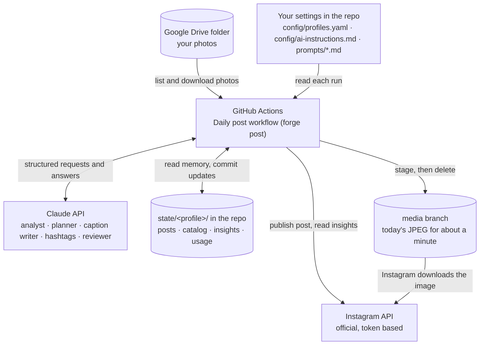
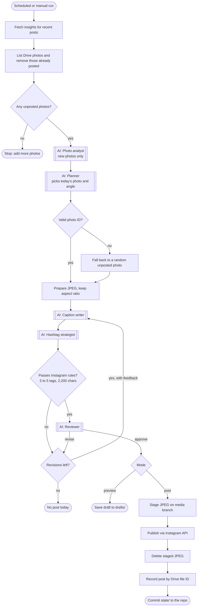
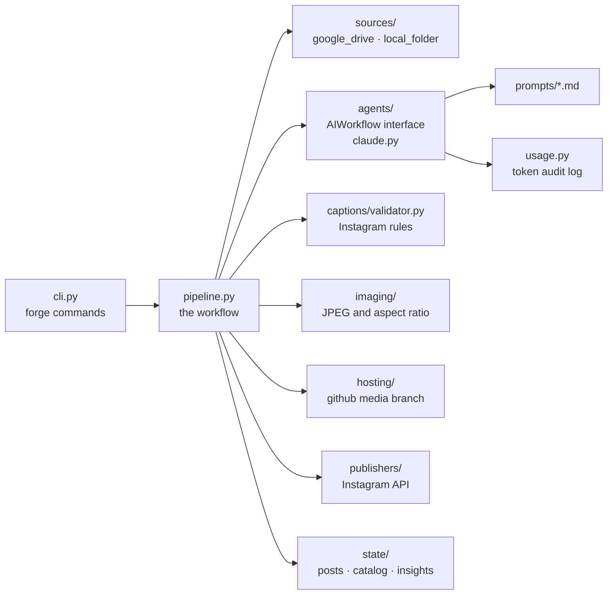

# Architecture

instaPostsForge is an **AI workflow**: plain code runs a fixed sequence of steps every day, and calls Claude at five of them. The AI never decides which steps run or touches Instagram directly. Code validates everything the AI produces before it can be posted.

## System overview

Instagram only accepts a public image link and rejects Google Drive links, so the day's photo is staged on the repo's `media` branch while Instagram downloads it.

## The daily run

Double-bordered boxes are Claude calls. Each one is logged to `state/<profile>/usage/` with its tokens and estimated cost.

## Code layout

Every box under `pipeline.py` sits behind a small interface (`PhotoSource`, `AIWorkflow`, `ImageHost`, `Publisher`). The tests swap in fakes, so they run without any accounts.

## Which agentic pattern is this?

In the terms of Anthropic's [Building effective agents](https://www.anthropic.com/engineering/building-effective-agents), this is a **workflow**: "LLMs and tools orchestrated through predefined code paths". It is not an autonomous **agent**, where the model decides its own steps and tool calls in a loop. A daily post has well-known steps, so a workflow is cheaper, more predictable and easier to test. That follows the guidance to use the simplest design that works.

It combines these building blocks and patterns:

| Pattern | Where it appears |
| --- | --- |
| **Augmented LLM** (the building block) | Each Claude call gets structured outputs (Pydantic schemas) and memory: the photo catalog, post history and insights in `state/`. No tools are exposed to the model. |
| **Prompt chaining** | Analyst → planner → caption writer → hashtag strategist → reviewer. Each step's output is the next step's input, with programmatic **gates** in between: the planner's photo ID must exist, and captions and tags must pass `captions/validator.py`. |
| **Evaluator-optimizer** | The reviewer (evaluator) approves a post or returns feedback. The caption writer and hashtag strategist (optimizers) then revise. The loop is bounded by `ai.max_revisions` (2), only the part that failed is redone, and a rule failure also feeds back as feedback. The capture date from EXIF or the file name is passed in as `taken_at`, so the evaluator can verify dates the writer uses. |
| **Routing** (light) | The analyst classifies each photo into one of 12 categories and 8 moods. Code then routes only that category's and mood's playbook (`config/playbooks/`) to the caption writer, hashtag strategist and reviewer. The path stays the same; the instructions change per photo. |
| **Guardrails and fallbacks** | Code, not the model, enforces Instagram's limits and the content rules: it skips screenshots, photos with children (unless allowed) and near-duplicates of recent posts, keeps categories and moods varied, drops quotes on food and animal posts, hides private locations, refuses unverified quote authors, falls back to a random photo when the planner fails, and skips the day rather than post an unapproved caption. A failed reviewer checklist item always means revise. |
| **Human in the loop** (optional) | `forge plan` and `forge preview` (or those modes in the Actions workflow) show the AI's choices without posting. |

Patterns it deliberately does **not** use (yet):

| Pattern | Why not, or how it could be added |
| --- | --- |
| Parallelization | Photo analyses run one after another. They could run in parallel (sectioning) or via the Message Batches API at half the price. Generating three captions and letting the reviewer pick one would be parallelization by voting. |
| Orchestrator-workers | The planner orders photos but doesn't spawn sub-tasks; the steps are fixed in code. |
| Autonomous agent | The model never chooses which step comes next or calls Instagram itself. This keeps a public account safe from an unexpected loop or post. |
