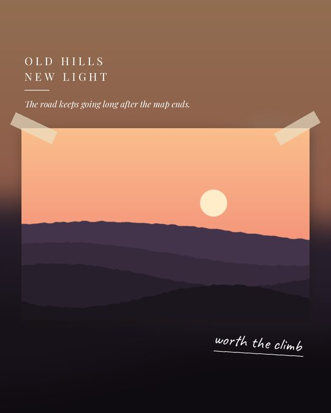
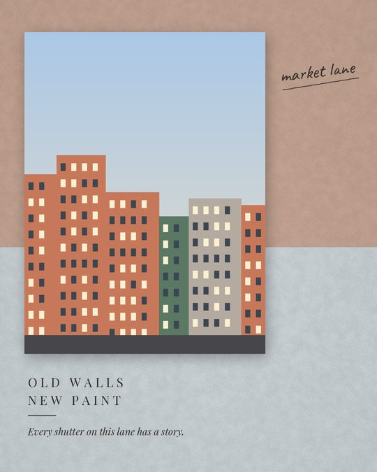
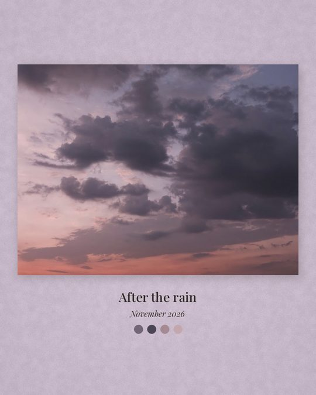
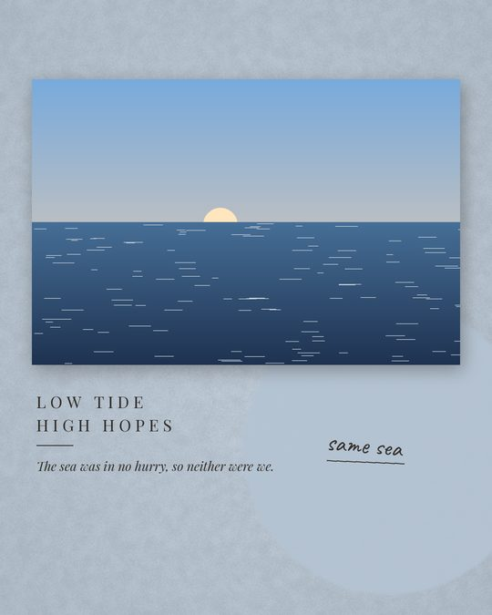
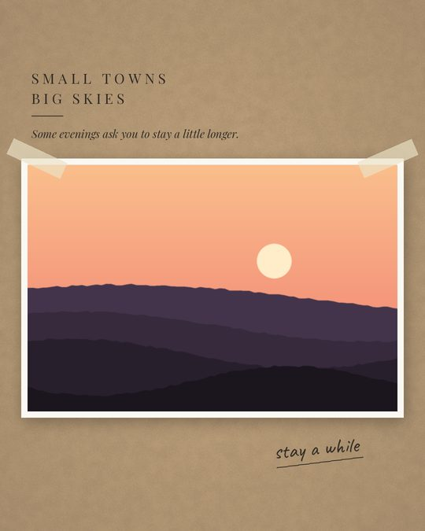
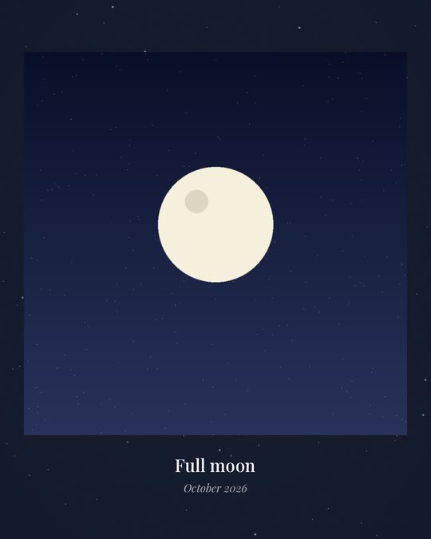
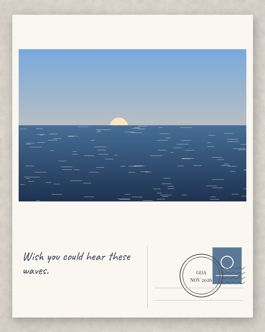
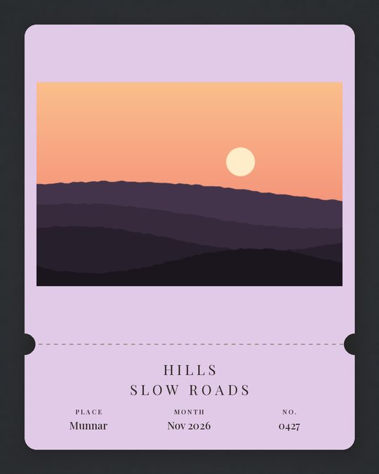
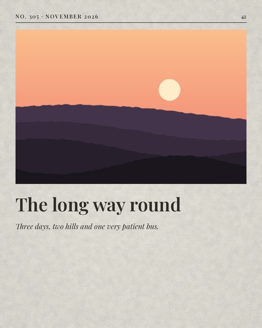
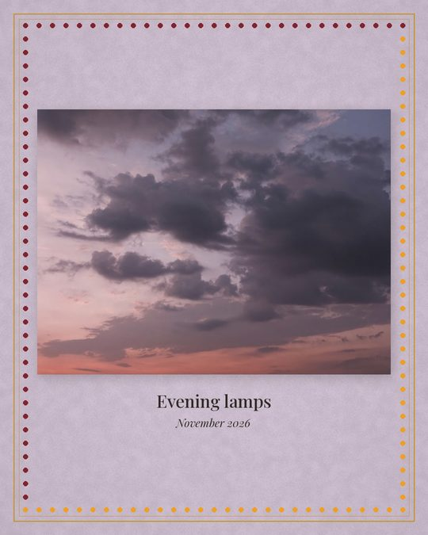

# Post styles: what each one looks like

These are rough examples drawn by the real layout code (`src/instapostsforge/imaging/layouts.py`). The sky photo is from the account; the other "photos" are simple placeholder scenes, so judge the layout, not the pictures. Every slide is 1080×1350 (4:5). By default the AI picks a style for each post. How to choose one yourself is in the README, under [Post styles](../README.md#post-styles).

The words on each image come from the caption writer and go through the same checks as the caption: the blocked-terms list, the length limits and the reviewer.

## Poster

The photo as a large print on paper, with a title in spaced capitals, a quiet line under it and a handwritten note. **No two posters need look alike:** the layout suits the photo's shape, and each post gets its own combination of layout, finish (plain, white border, taped corners, a slight tilt) and paper tone (cream, oat, sage, mist blue, blush). A re-run on the same day gives the same look, so a preview matches what posts.

| Wide photo: words under it | Wide photo: words above it | Wide photo: edge to edge |
| --- | --- | --- |
|  |  |  |

| Tall photo on the left | Tall photo on the right | Square photo |
| --- | --- | --- |
|  |  |  |

Layouts by shape: wide photos (`wide_top`, `wide_low`, `wide_band`), tall photos (`tall_left`, `tall_right`, `tall_centre`) and square ones (`square_top`, `square_left`). Your own decoration PNGs in `config/decor/` (a leafy branch, a sprig) are added at the top left.

## Gallery frame

The photo on an off-white margin with a small museum-style label: the title the AI writes, then the place and month, which come from the photo's notes and never from a guess.

## Grid

2 to 9 photos from one outing or place, tiled on the first slide with a short line across the middle. Each photo then follows on its own slide, on a gallery margin. The grid sizes are 9 (3×3), 6 (2×3), 4 (2×2), 3 (one tall and two stacked) and 2 (side by side).

| 9 photos | 4 photos | 3 photos, no title | Each photo on its own slide |
| --- | --- | --- | --- |
|  |  |  |  |

## Story

A short story told in slides: the cover photo edge to edge with a title, the other photos on gallery margins, and a closing line on paper.

| Cover | Closing slide |
| --- | --- |
|  |  |

## Panorama

A wide photo (3:2 or wider) cut into 2 or 3 slides that join up as you swipe. No text.

## Notes

The photo exactly as shot, then the same photo with a hand-drawn layer on top. The analyst names up to three things in the photo and where they are, and the caption writer writes a short note for each. Code places every mark: never inside the subject, never on a person, and never on a photo of a deity, shrine or prayer.

| Slide 1: as shot | Slide 2: field notes | Star map |
| --- | --- | --- |
|  |  |  |

| Film date stamp | Doodles | Magazine cover |
| --- | --- | --- |
|  |  |  |

| Viewfinder | Photographer's notes | Tape label |
| --- | --- | --- |
|  |  |  |

## Looks: backgrounds and frames

On top of the style, code picks a look by rule, with no AI call: the photo's mood and category choose the candidates, the date picks one, and the last post's look is skipped. Narrow them in `selection.style.looks`.

Backgrounds are drawn from the photo's own colours or a plain paper texture. Text is checked for contrast, and flag or party colour sets never appear together.

| Blurred echo | Two tones | Colour swatches |
| --- | --- | --- |
|  |  |  |

| Sun shape | Kraft paper | Night navy |
| --- | --- | --- |
|  |  |  |

Frames suit the kind of photo: a postcard or ticket for travel and landscapes, film for street and night, a magazine page for city and abstract photos, instant prints for a set of two to four, and a festive border for devotional photos. The place and month come from code, and no frame copies a real brand, ticket or stamp.

| Postcard | Ticket stub | Film strip |
| --- | --- | --- |
|  |  |  |

| Magazine page | Instant prints | Festive border |
| --- | --- | --- |
|  |  |  |

## Any (the default)

The AI planner picks one of the styles above for each post from what the analyst saw in the photos: a panorama for a wide landscape, a poster for a quiet or nostalgic photo, a gallery frame for a strong clean one, a grid or story for a set. It avoids the last post's look. If its pick can't be drawn (a panorama of a photo that isn't wide), code picks one that suits the photos' mood. Limit its choices with `selection.style.any_styles`; plain `single` posts happen only when you choose them, or add `single` to that list.
