# Post styles: what each one looks like

These are rough examples drawn by the real layout code (`src/instapostsforge/imaging/layouts.py` and `carousels.py`). The sky photo is from the account; the other "photos" are simple placeholder scenes, so judge the layout, not the pictures. Every slide is 1080×1350 (4:5). By default the AI picks a style for each post. How to choose one yourself is in the README, under [Post styles](../README.md#post-styles).

The words on each image come from the caption writer and go through the same checks as the caption: the blocked-terms list, the length limits and the reviewer.

## What changed in November 2026

The poster (a taped print on paper with a spaced title and a handwritten note), the gallery frame and the postcard, ticket, magazine and festive frames were retired. They were all one move, a photo on a margin with a label, and on the profile grid every tile looked alike. The new styles below open on the photo itself and use the swipe to show something new. Each one comes from a format photographers already use on Instagram; the inspiration is named under each.

## Palette

The photo, then a card with the colours it is made of. Code finds the colours and names them from a fixed list of plain names (laterite, monsoon blue, turmeric), with the hex code under each; the caption writer only writes the title. Colour sets that read as a flag are thinned out first.

*Inspired by @colorpalette.cinema, which pairs film stills with their colour palettes.*

| The photo | Its colours |
| --- | --- |
| 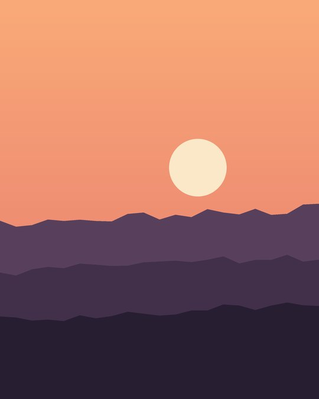 | 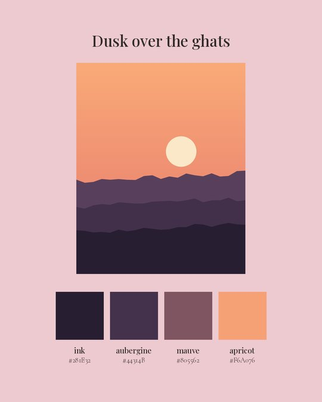 |

## Details

The photo, then a close crop on each of two or three things the analyst pointed at, with a small map of the whole photo in the corner showing where the crop came from and the writer's short label. Crops are only cut from the original, never sharpened or filled in, and a crop that would be too soft (from a small photo) or would repeat another is skipped. Never centred on a person. With fewer than two good crops the post becomes a palette.

*Inspired by the zoom-in carousel photographers use to walk a viewer through a busy frame.*

| The photo | First detail | Second detail |
| --- | --- | --- |
| 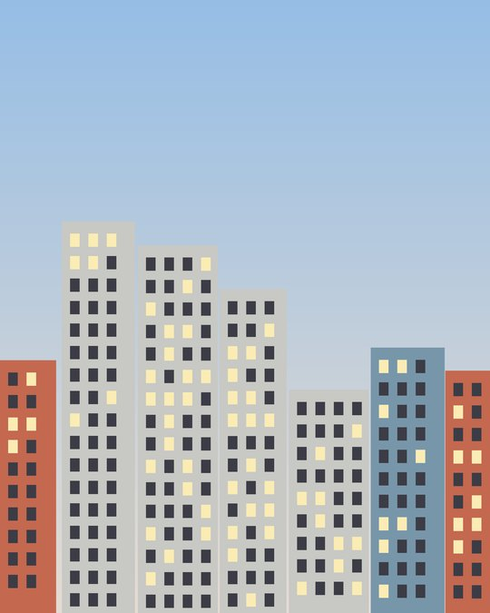 | 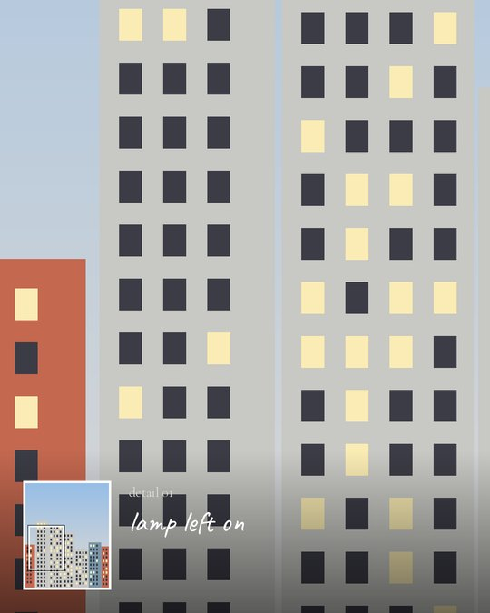 | 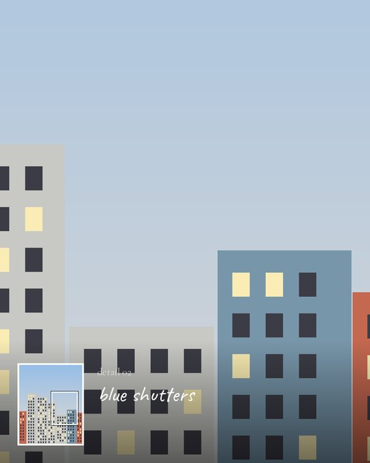 |

## Film

One photo on a strip of film with its frame number and a short title. (It used to be one of the gallery frames; it is now a style of its own.)

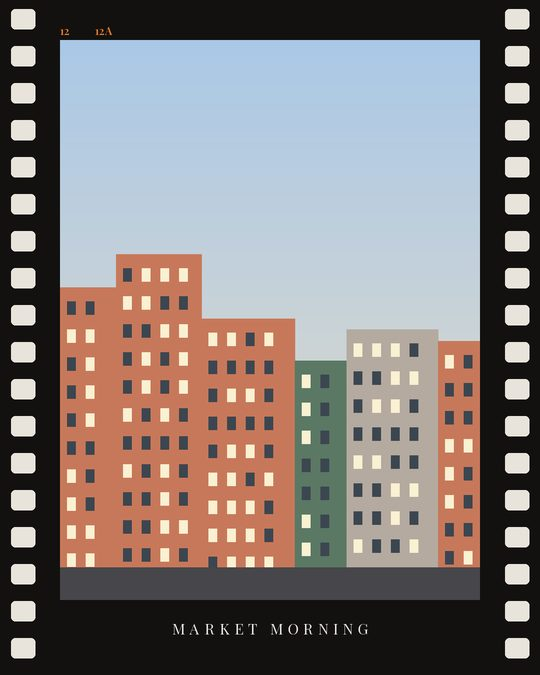

## Contact sheet

For a set of 3 to 9 photos: the best photo first, then all of them on a black film contact sheet with frame numbers along the edges, the best one circled in red grease pencil and the writer's short note scrawled under it ("the keeper"). The place and month at the top come from code. Then the other photos, each on its own slide.

*Inspired by Magnum Photos (@magnumphotos) contact sheets, and the photographers who share theirs to show how they work a scene.*

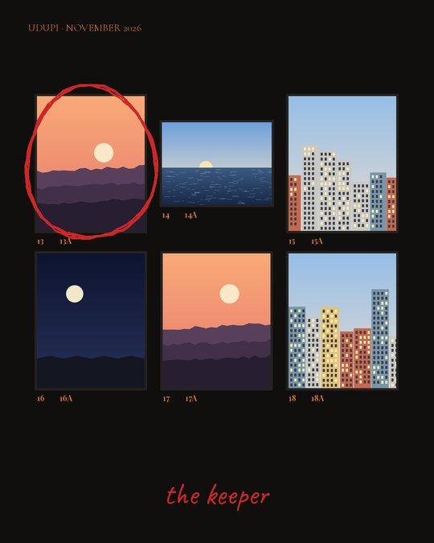

## Seamless

For a set of 2 to 4 photos: one wide canvas, two or three slides long, in a deep tone of the cover's own colours. The photos are placed so they cross from one slide into the next, and one hand-drawn line runs through every slide with the writer's title at its start, so swiping feels like following a route.

*Inspired by split panoramas (as landscape photographer Mark Gray posts them) and seamless carousels.*

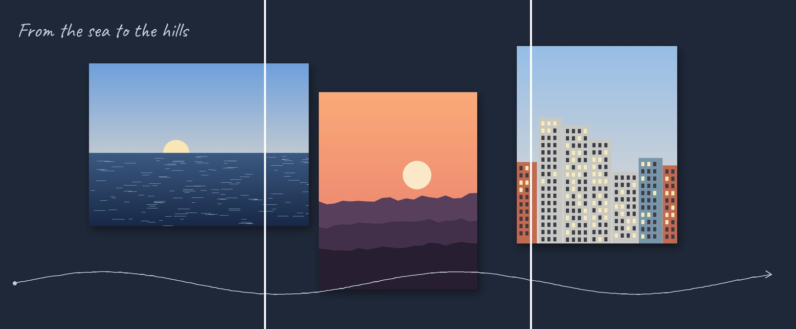

## Sequence

For 3 to 8 photos of one scene taken minutes apart (a sunset, a festival evening, a street filling up): the strongest photo first, then the rest in the order they were taken, each with its time from the photo's own clock and a row of dots showing where it sits in the run. Offered only when every photo has a capture time and they all fall within three hours; otherwise the set is told as a story. Nothing is written by the AI.

*Inspired by the "passage of time" carousel.*

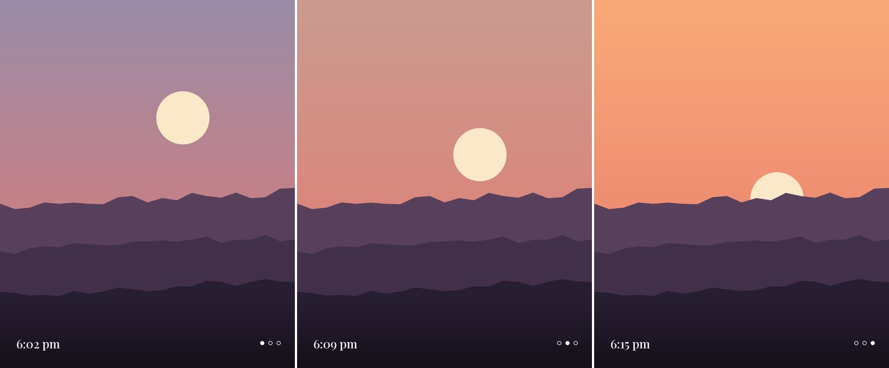

## Grid

2 to 9 photos from one outing or place, tiled on the first slide with a short line across the middle. Each photo then follows on its own slide, full-bleed when it is close to 4:5, otherwise whole on a mat in a deep tone of its own colours. The grid sizes are 9 (3×3), 6 (2×3), 4 (2×2), 3 (one tall and two stacked) and 2 (side by side).

| 9 photos | 4 photos | 3 photos, no title | Each photo on its own slide |
| --- | --- | --- | --- |
|  |  |  |  |

## Story

A short story told in slides: the cover photo edge to edge with a title, the other photos each on their own slide, and a closing line on paper.

| Cover | Closing slide |
| --- | --- |
|  |  |

## Panorama

A wide photo (3:2 or wider) cut into 2 or 3 slides that join up as you swipe. No text.

## Notes

One image: the photo with a hand-drawn layer on top. The photo's own pixels are never changed; the marks are drawn on a layer over it. (It used to be the clean photo and then the marked copy, which read as the same photo posted twice.) The analyst names up to three things in the photo and where they are, and the caption writer writes a short note for each. Code places every mark: never inside the subject, never on a person, and never on a photo of a deity, shrine or prayer.

| The photo | With field notes | Star map |
| --- | --- | --- |
| 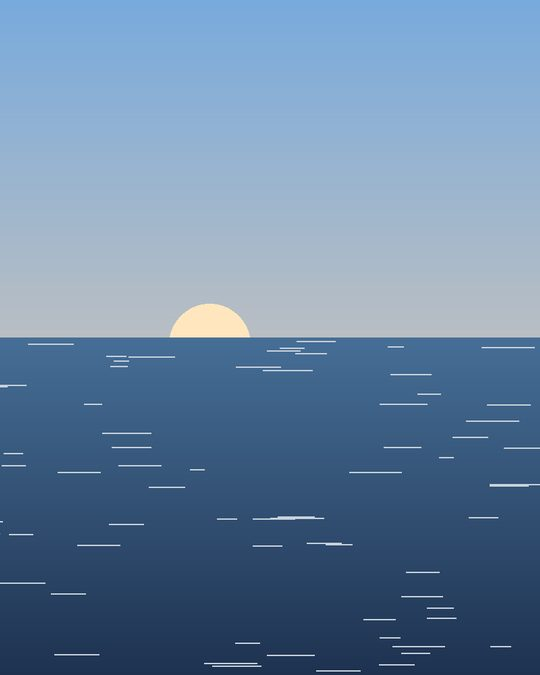 | 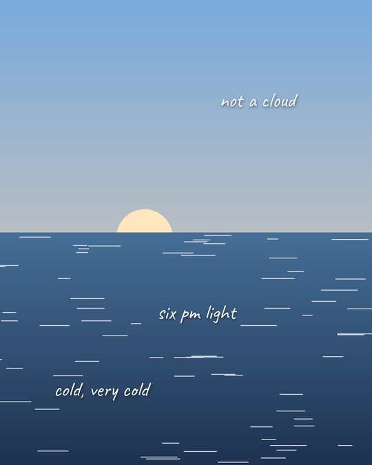 | 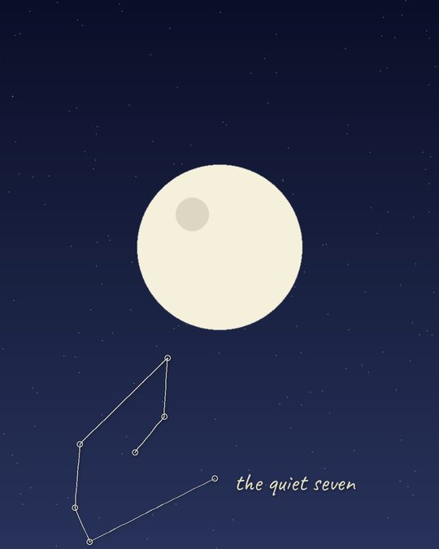 |

| Film date stamp | Doodles | Magazine cover |
| --- | --- | --- |
| 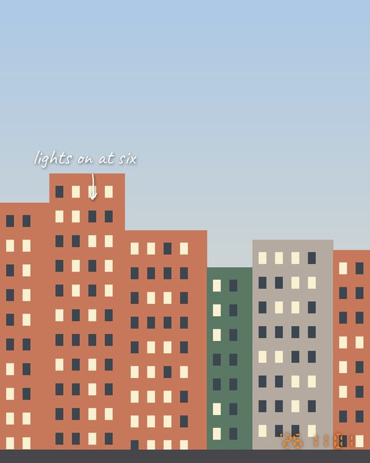 | 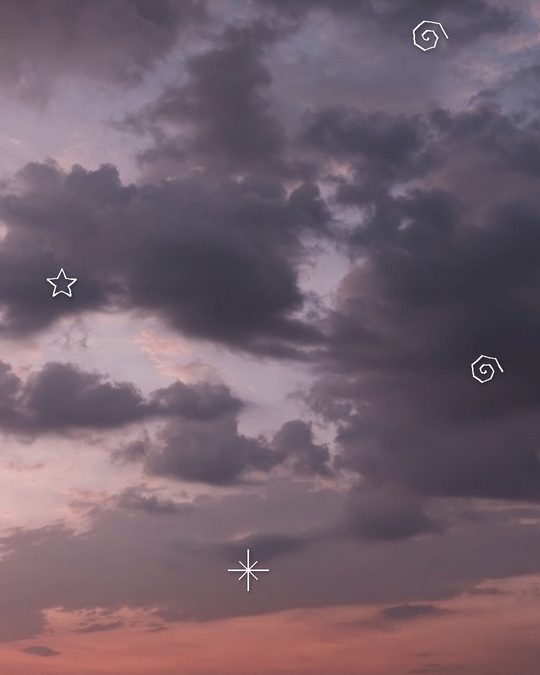 | 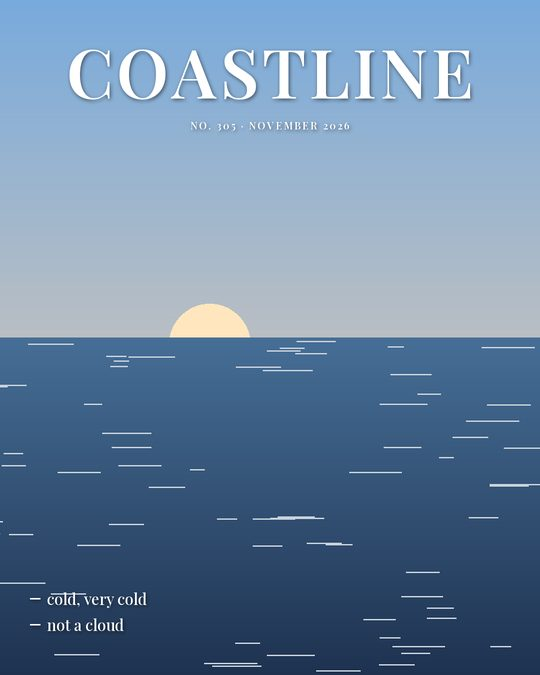 |

| Viewfinder | Photographer's notes | Tape label |
| --- | --- | --- |
| 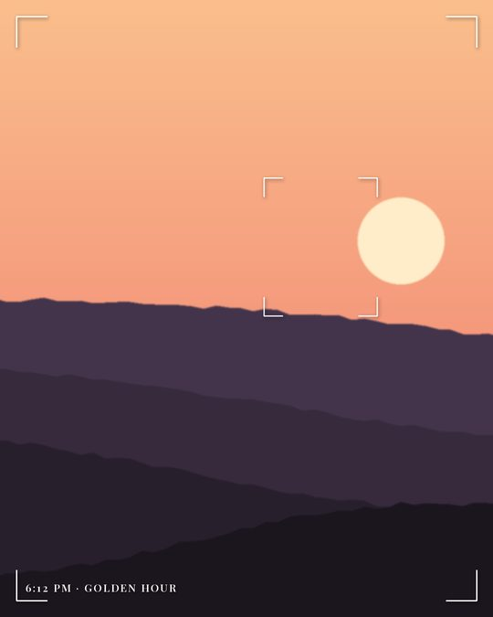 | 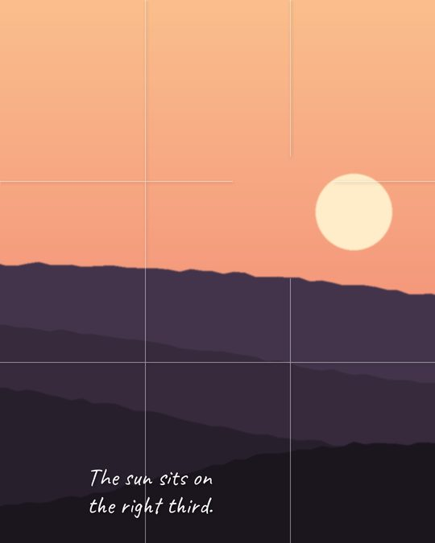 | 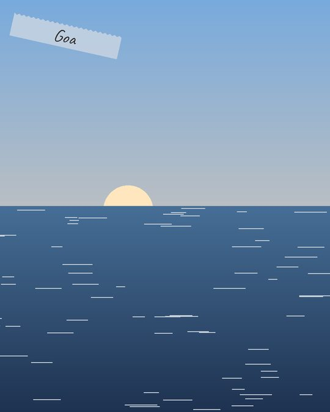 |

### Sketch marks

Quiet pen marks taken from how photographers and illustrators doodle on prints: one colour, a thin wavering line, drawn in the empty space around the subject so the photo still reads first. A look carries one of them, sometimes with the date stamp or a single handwritten word.

- **Ring:** a loose loop around a lone subject (a moon, a lamp, a flower, an animal), left open like a pen stroke, with a small dot riding on it.
- **Rays:** a few short strokes off a bright subject, like a sketch of its glow.
- **Birds:** two or three gulls in the calmest part of an open sky.
- **Aside:** one handwritten word or two with a loose underline, near the subject (the caption writer writes it, at most 24 characters).

| Ring and date stamp | Rays and an aside | Birds |
| --- | --- | --- |
| 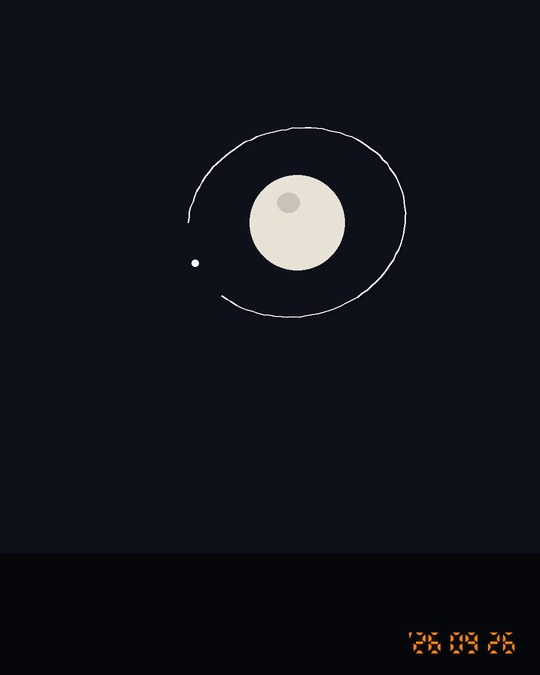 | 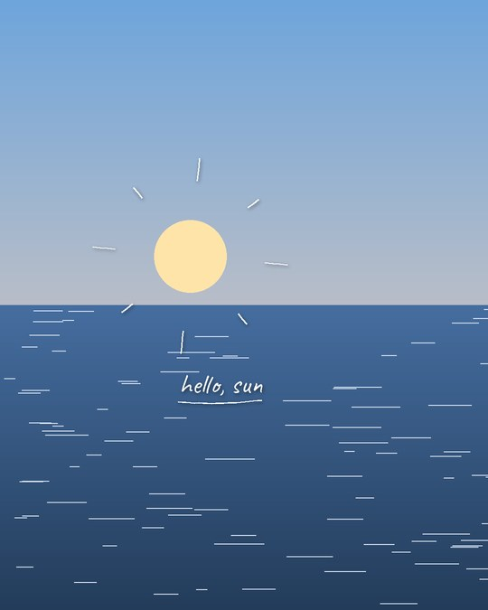 | 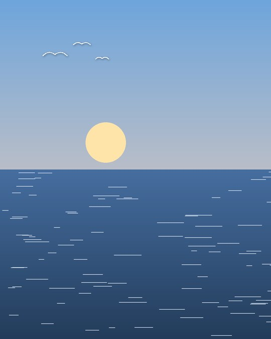 |

A ring or rays need a lone subject with room around it, and none of the four is drawn on a photo with people. Doodles are kept to two or three small marks. A post always carries more than a date stamp: when a look's marks can't be placed (a star map in a sky with no stars, say), code adds a ring or rays around the subject, or corner brackets.

## Pop-out

An editorial poster on light paper. The photo shows through a window, and its main subject steps out of the window onto the page: down onto a faded patch of its own ground (a person walking, a jeep), out of one side, or across the top and bottom of a narrow window. A large serif title sits above it with a small spaced label, a spaced line and up to four words along the foot. The title takes a deep colour from the photo when it reads on the paper.

The subject is found by a local segmentation model and the photo's own pixels are shown through that mask, never repainted. The alt text, and by default a short line after the caption, say the layout is a composite of the unedited photo. When the photo has no single clear subject, the subject touches the photo's edges, its edges are unsure (fog, glass, motion blur), or it's a devotional photo or has children, the post is a palette instead. Try one of your photos with `forge cutout -p main --photo <name>`, then `forge preview -p main --style popout`.

## Looks

On top of the style, code picks a look by rule, with no AI call: the marks on a notes post, the paper behind a pop-out, and instant prints for a grid of two to four. The photo's mood and category choose the candidates, the date picks one, and the last post's look is skipped. Narrow them in `selection.style.looks`.

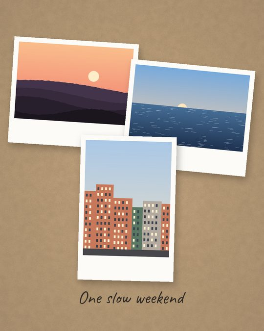

## Any (the default)

The AI planner picks one of the styles above for each post from what the analyst saw in the photos: a palette when colour is the story, details for a busy frame, a panorama for a wide landscape, a contact sheet, seamless strip or sequence for a set. Code keeps the feed varied: the planner's pick is turned down when the last post used the same style, and code's own pick avoids the styles of the last two posts. If a pick can't be drawn (a panorama of a photo that isn't wide), code picks one that suits the photos' mood. Limit its choices with `selection.style.any_styles`; plain `single` posts happen only when you choose them, or add `single` to that list.
